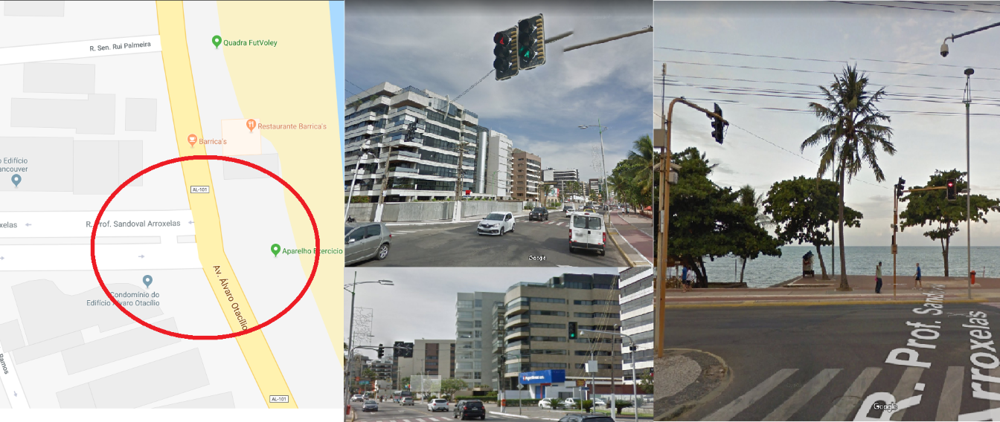
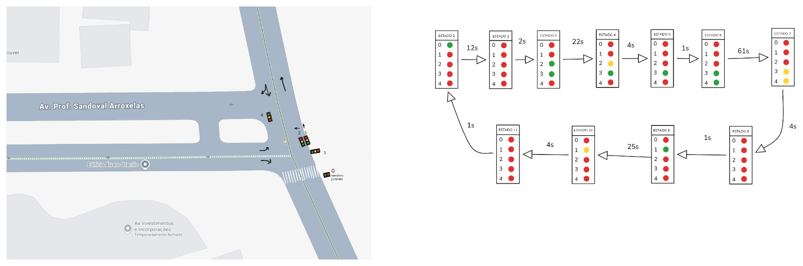
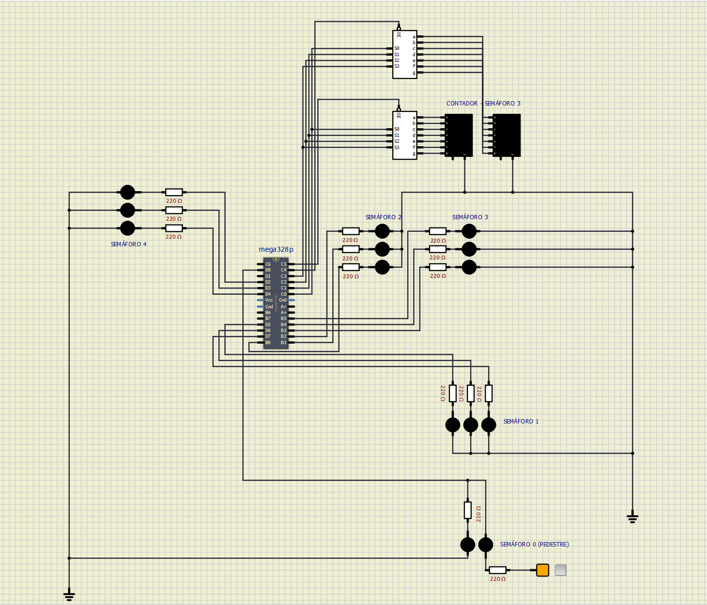
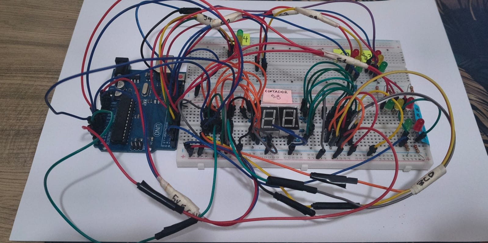
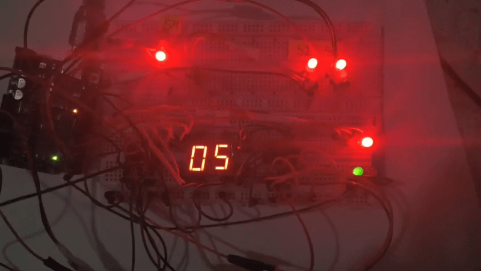

# Projeto 1 - Microcontroladores

Projeto em Assembly AVR que simula o funcionamento dos semáforos presentes no cruzamento da Av. Álvaro Otacílio com a R. Prof. Sandoval Arroxelas.

## Definições do Projeto

### Etapas

1. Fazer um estudo de campo para modelar o funcionamento dos semáforos. É importante anotar bem a temporização (dependendo do dia e hora os tempos dos semáforos podem mudar);
2. Definir a máquina de estados que representa a modelagem do semáforo;
3. Implementar código que simula o comportamento dos semáforos;
4. Reproduzir simulação no SimulIDE;
5. Montar circuito que simula o sinal;
6. Reproduzir simulação do circuito na protobard.

### Requisitos

- Deve-se utilizar os Timers do AVR para definir os tempos
- Deve-se utilizar interrupção ao invés de verificação de flag
- Deve-se apresentar o contador de um dos semáforos utilizando displays de 7seg. Pode utilizar o CI BCD.
- Deve-se enviar pela serial informações de status. Ex: "Semáforo 1 - Amarelo; Semáforo 2 - Verde; Semáforo 3 - Vermelho..."

### Equipamentos

- Controle feito por Arduino com código em Assembly
- Os semáforos devem ser implementados com três leds (vermelho, amarelo e verde)
- O valor do contador do semáforo deve ser implementado com dois displays de 7seg

## Implementação

Os videos foram gravados no período da noite e, através deles, foi construída a máquina de estados que modela o funcionamento dos semáforos.

O CI foi modelado no SimulIDE com todos os componentes necessários e com a correta atribuição de portas, visando a montagem na protoboard.

### Mapeamento

- Semáforo 0 (Pedestre): PD0 (Vermelho = 0, Verde = 1)
- Semáforo 1: PD7 (Vermelho) PD6 (Amarelo) PD5 (Verde)
- Semáforo 2: PB2 (Vermelho) PB1 (Amarelo) PB0 (Verde)
- Semáforo 3: PB5 (Vermelho) PB4 (Amarelo) PB3 (Verde)
- Semáforo 4: PD4 (Vermelho) PD3 (Amarelo) PD2 (Verde)
- 2 BCDs: PC0 (S0) PC1 (S1) PC2 (S2) PC3 (S3) PC4 (OE BCD1) PC5 (OE BCD2)
- Serial (USART0): PD1 (TX), 9600 baud, 8N1, transmissão por interrupção
  (UDRE). Envia uma linha de texto a cada mudança de estado.
- O programa assume displays multiplexados, OE ativo em zero,
  LEDs acesos com nivel alto e clock de 16 MHz.

### Montagem

O componente BCD utilizado foi um CD4511BE, que ativa o display em 1 (diferente da simplificação utilizada no SimulIDE). Dessa forma, os pinos PC4 e PC5 foram trocados na montagem dos displays.

